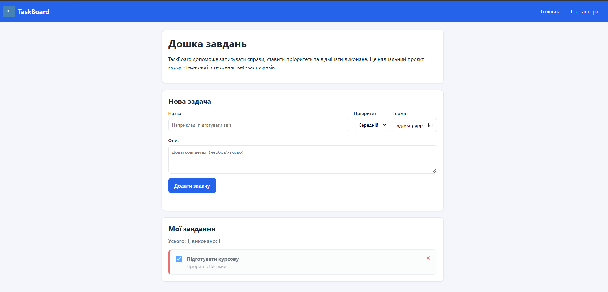
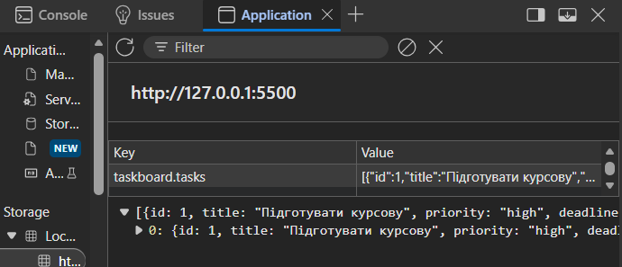

# TaskBoard
# TaskBoard — дошка завдань

Навчальний наскрізний проєкт з дисципліни «Технології створення веб-застосунків».

## Автор

- **Ім'я:** Дмитро Василевич
- **Група:** КН-3/1

## Про проєкт

TaskBoard — вебзастосунок для створення завдань, керування їхнім статусом і відстеження виконання. Проєкт розвивається поетапно протягом курсу.

## Технології

| Шар | Технології |
|---|---|
| Frontend | HTML5, CSS3, JavaScript |
| Backend | Python, Flask (заплановано) |
| База даних | SQLAlchemy, PostgreSQL (заплановано) |
| Розгортання | Docker (заплановано) |

## Реалізований функціонал

- Додавання завдань через форму без перезавантаження сторінки.
- Вибір пріоритету завдання.
- Встановлення терміну виконання.
- Додавання опису завдання.
- Позначення завдань як виконаних.
- Видалення завдань.
- Відображення кількості всіх і виконаних завдань.
- Збереження завдань у `localStorage`.

## План розвитку

- [x] Репозиторій і перша сторінка
- [x] Адаптивна верстка (HTML + CSS)
- [x] Інтерактивність (JavaScript і DOM)
- [ ] Серверна частина на Flask
- [ ] База даних та користувачі
- [ ] Docker
- [ ] REST API і тести
- [ ] Публікація онлайн

## Як запустити

1. Склонуй репозиторій:

   ```bash
   git clone https://github.com/Dima-200/taskboard.git
   ```

2. Відкрий папку проєкту у VS Code.
3. Запусти файл `index.html` через розширення Live Server.

## Скріншоти

### Інтерфейс TaskBoard



### Збереження завдань у localStorage



## Демо

[Відкрити сайт TaskBoard](https://dima-200.github.io/taskboard/)